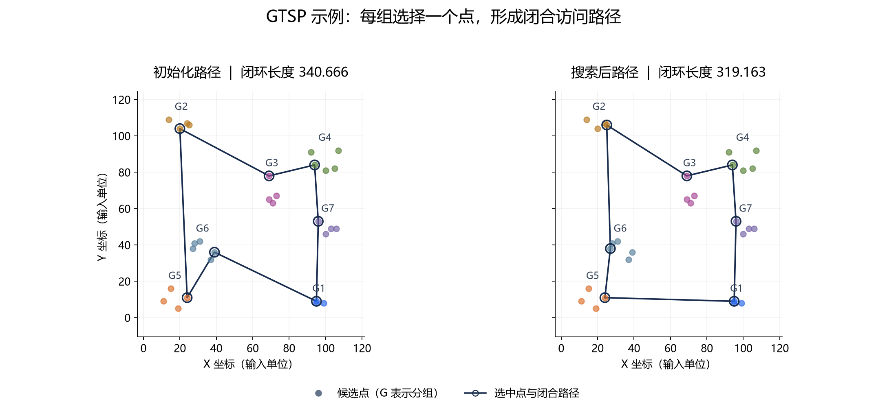
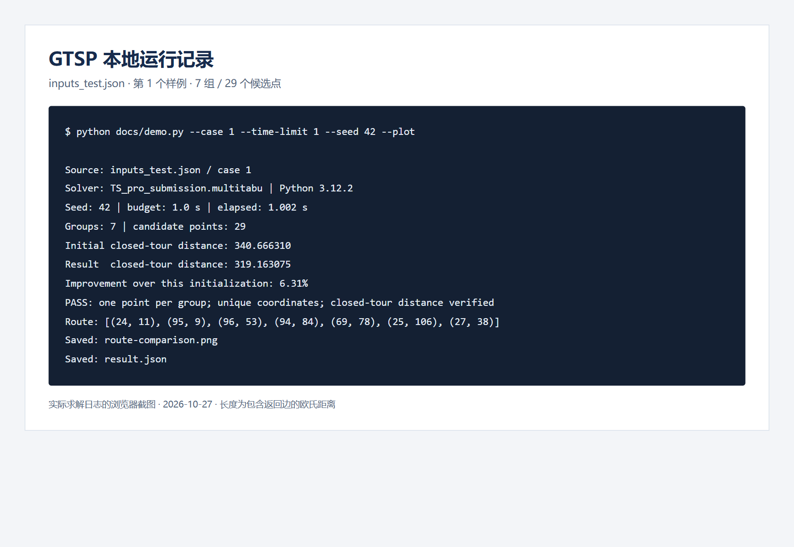
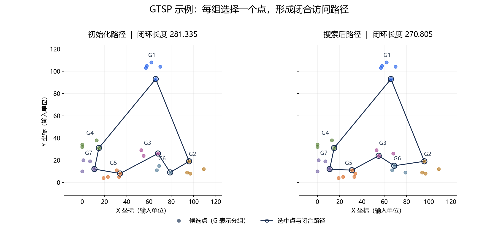

# Multi-tabu · 广义旅行商问题求解

面向二维欧氏距离的 **广义旅行商问题（Generalized Traveling Salesman Problem）** 实验代码：将候选点划分为若干组，每组选择一个点，联合优化选点与访问顺序，寻找总长度更短的闭合路径。

仓库保留了 `TS`、`tabu`、`multitabu` 等实验命名，包含多种初始化策略、四类邻域操作、限时多起点搜索、样例数据和可视化工具，适合组合优化学习与算法复现实验。



上图由仓库 `inputs_test.json` 的第 1 个样例实际运行生成：7 组、29 个候选点，随机种子 `42`，搜索预算 `1.0` 秒。闭环长度从本次初始化的 **340.666** 降至 **319.163**，缩短约 **6.31%**。这是单个样例的观测结果，不代表所有数据上的平均性能，也不构成全局最优性保证。

## 问题定义

输入为分组后的二维坐标。目标是在每组恰好选择一个点的条件下，最小化访问这些点并回到起点的欧氏距离总和：

```text
目标：d(v1, v2) + d(v2, v3) + … + d(vm, v1)
约束：每组恰好选取一个候选点；选中坐标不重复。
```

坐标单位沿用输入数据。返回的坐标序列不重复附加起点，但计算路径长度时包含末点回到首点的边。

## 算法实现

主要入口是 `TS_pro_submission.multitabu(...)`，实现流程如下：

1. **计算距离矩阵**：预计算候选点之间的欧氏距离。
2. **构造初始解**：比较质心选点、靠近原点的组内选点、多次随机起点贪心初始化，保留成本较低的路径。该版本的随机初始化函数仍保留在代码中，但当前初始化分支只抽取 `greedy`。
3. **生成邻域候选**：随机使用交换访问顺序（`swap`）、节点重插入（`relocate`）、片段反转（`reverse`）或组内替换选点（`swap_within_layer`）。
4. **更新当前解与历史最优解**：选择本轮候选中的较低成本路径，保存搜索过程中的最优结果。
5. **限时重启**：在剩余时间内继续尝试新的初始解，返回本次运行找到的最好路径。

**实现说明：** 当前主版本维护并更新 `tabu_list`、`tabu_time`，但候选生成和选择没有读取禁忌表进行过滤。因此，现有行为更接近多起点随机邻域搜索；完整的禁忌过滤与特赦准则仍需后续补充。

## 快速开始

### 无第三方依赖的单例求解

`TS_pro_submission.py` 仅使用 Python 标准库。先克隆仓库：

```bash
git clone https://github.com/YiYun-ll/Multi-tabu.git
cd Multi-tabu
```

运行新增的演示脚本：

```bash
python docs/demo.py --case 1 --time-limit 1 --seed 42
```

它会读取 `inputs_test.json`，调用原求解器，验证分组覆盖、坐标唯一性和闭环长度，将结果写入 `demo-output/result.json`。演示脚本使用 `ast.literal_eval` 解析内置样例，不改变求解器算法。

### 生成路径图

安装绘图依赖后加上 `--plot`：

```bash
python -m pip install "matplotlib>=3.6"
python docs/demo.py --case 1 --time-limit 1 --seed 42 --plot
```

输出文件：

- `demo-output/result.json`：参数、实际耗时、初始化长度、结果长度、选中坐标及约束检查状态。
- `demo-output/route-comparison.png`：同一坐标尺度下的初始化 / 搜索结果对比。

绘图优先使用 Microsoft YaHei 或 SimHei；缺少中文字体的系统需自行安装字体。固定随机种子可以控制随机数序列，但限时终止受 CPU 性能与系统负载影响，不保证跨机器逐位一致。

### 标准输入模式

也可直接运行原提交入口：

```bash
python TS_pro_submission.py
```

输入一行分组坐标，组与组之间使用 `@` 分隔：

```text
[(0,0),(0,1)]@[(4,0),(4,1)]@[(2,3),(2,4)]
```

程序输出一条坐标序列。该入口内置 `time_limit = 0.1` 秒；需要更长预算时可修改该值，或使用演示脚本的 `--time-limit` 参数。

原入口内部使用 `eval` 解析输入，**仅应运行可信的本地样例**。如需接收外部输入，应先替换解析方式并增加数据校验。

## 批量实验

原有 `solver.py` 默认导入 `TS_pro_submission`，读取 `loop_random.json`，每个样例使用约 `5` 秒预算：

```bash
python -m pip install matplotlib tqdm
python solver.py
```

`loop_random.json` 包含 200 条带参考路径与参考长度的样例，全部运行的搜索预算合计约 1,000 秒。切换算法时修改 `solver.py` 的导入语句；切换数据时修改 `test_file`。

使用 `solver.py` 时，数据必须同时包含 `input`、`output`、`distance` 字段。仓库数据分为：

- `loop_random.json`：200 条，含输入、参考路径和参考长度。
- `loop_random2.json`：300 条，含输入、参考路径和参考长度。
- `inputs_test.json`：2 条，仅输入，适合用 `docs/demo.py` 快速演示。
- `inputs.json`、`overlap_inputs.json`：各 500 条，仅输入，不可直接代入原 `solver.py` 的参考答案评分逻辑。

原评分逻辑使用循环路径等价检查或距离的精确相等判断。对于浮点距离，进行独立评测时建议用 `math.isclose` 并明确容差；参考字段不应在缺少独立证明时直接称为全局最优答案。`solver.py` 只在其失败分支保存图片；需要稳定生成展示图时使用上面的演示脚本。

## 运行截图与第二个样例

下面是对本次实际运行日志进行浏览器排版后截取的图片，内容对应 [原始运行日志](docs/example-run.txt) 和 [结果 JSON](docs/example-result.json)。



第 2 个样例同样为 7 组、29 个候选点；相同随机种子和时间预算下，本次闭环长度从 **281.335** 降至 **270.805**，缩短约 **3.74%**。详见 [第 2 个样例结果](docs/example-result-case2.json)。



这些图片均根据实际返回的坐标绘制。圆圈标识选中点，连线包含闭环边；不同分组同时以颜色和 G 编号区分。

## 文件导航

```text
Multi-tabu/
├── TS_pro_submission.py   # 主要提交入口：标准库、单行输入输出
├── TS_pro.py              # 带多策略初始化的实验版本
├── TS.py / TS_gai.py      # 其他搜索实验版本
├── TS_distance.py        # 距离相关实验版本
├── TS_submission.py      # 较早的提交版本
├── solver.py             # 带参考结果数据的批量实验入口
├── utils.py              # 输入转换、绘图与循环等价检查
├── image.py              # 记录迭代距离的可视化实验脚本
├── dif_generate.py       # 数据生成辅助脚本
├── *.json                # 输入与带参考结果的实验数据
└── docs/
    ├── demo.py           # 可复现演示与路径约束检查
    ├── example-result*.json
    ├── example-run.txt
    └── images/           # 本次真实运行生成的图与日志截图
```

`old.py`、`backup.py` 与 `TS_pro.txt` 为历史实验文件，首次使用建议从 `docs/demo.py` 或 `TS_pro_submission.py` 开始。

## 验证范围与限制

展示图于 **2026 年 10 月 27 日** 在 Windows、Python **3.12.2** 下生成，调用原有 `TS_pro_submission.multitabu`，每个演示样例的搜索预算为 `1.0` 秒。

约束检查确认每组恰好选点一次、坐标互异，并独立重算包含返回边的路径长度。演示脚本还检查结果不劣于相同随机种子的首个初始化解。它验证可行性与数值一致性，不证明全局最优。

当前实现适合实验复现，使用时还需考虑：

- 主要针对非空、可行的二维坐标分组；重复坐标、组间共享点、过短预算及极小分组等边界输入未被原始入口完整处理。
- 时间预算按搜索阶段检查，不是严格的进程截止时间，初始化和距离矩阵计算可能造成超时。
- 距离矩阵需要 `O(N²)` 空间；候选路径通过完整重算长度评价，较大规模问题需进一步优化。
- 多个脚本包含不同的默认数据文件和时间预算，直接比较结果前需统一配置。

## 交流与授权

欢迎通过 [Issues](https://github.com/YiYun-ll/Multi-tabu/issues) 反馈算法问题，并附输入样例、随机种子、时间预算和运行环境。

仓库当前未提供 `LICENSE` 文件；如需使用或再分发代码与数据，请先与维护者确认授权范围。
